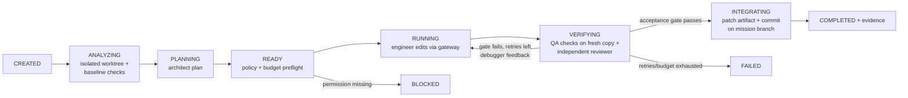

# Scrappy Engine — SE-001 implementation status

Scrappy Engine is the mission layer on top of Scrappy Forge's execution substrate
(`src/scrappy_engine/`). This file tracks the SE-001 blueprint against code that
exists and is tested. If something is not listed as implemented, it is not implemented.

> The LLM proposes. The policy engine decides. The tool gateway executes.
> QA and an independent reviewer produce evidence. The acceptance gate decides.

## Mission loop (build-order items 1, 2, 4 and 6: first slice)



Each `step()` performs one state's work and commits exactly one transition in a
SQLite transaction. A new process resumes any non-terminal mission after
`store.recover()` marks interrupted tool calls `uncertain` and agent runs `interrupted`.

## Status against the blueprint

| SE-001 item | Status | Where |
| --- | --- | --- |
| Mission lifecycle states (all 12) with enforced transitions | Implemented; `DEPLOYING` is reachable in the table, but no handler exists yet | `states.py` |
| Durable mission store, transactional transitions, optimistic versioning | Implemented (SQLite WAL) | `store.py` |
| Tables: projects, missions, tasks, agent_runs, tool_calls, artifacts, decisions, audit_events | Implemented (SQLite) | `store.py` |
| Append-only audit with hash chain | Implemented (triggers + chain check) | `store.py` |
| Tables: users, memory_records, skill_registry, skill_evaluations, model_registry, evaluation_runs, approval_policies | Not implemented | — |
| PostgreSQL / pgvector backend | **Not implemented.** The schema mirrors SE-001 so a Postgres backend can implement the same methods | — |
| Redis coordination | Not implemented (not needed for the single-worker loop) | — |
| Idempotent mission creation | Implemented (key reuse with a different payload → 409) | `store.py`, `api.py` |
| Tool execution contract (tool, mission, role, schema, scope, timeout, idempotency key, execution id, output, evidence hash, status) | Implemented. Recorded before execution, so crashes leave evidence | `tools.py` |
| Autonomy levels A0–A5 + per-role scopes | Implemented. A5 is refused at mission creation | `autonomy.py` |
| Separation of duties | Enforced. Only QA can run checks; reviewers and architects are read-only; reviewer ≠ implementer is checked by the gate | `autonomy.py`, `runner.py` |
| Isolation: git worktree on `scrappy/<mission>` branch, or snapshot copy | Implemented; the operator checkout is never edited | `workspaces.py` |
| Docker sandbox for checks | Reuses Forge `Runner` (no network, read-only root, dropped caps, limits). `trusted-local` must be chosen explicitly | `scrappy_forge/execution.py` |
| Model independence | Implemented: provider protocol + `ChatJSONProvider` (OpenRouter-free/loopback via Forge) + `ScriptedProvider` | `intelligence.py` |
| Routing: failure/failover, diversity for review, per-role preference | Implemented (basic). Capability/cost/performance routing lives in Forge `model_router.py` and is not yet wired in | `intelligence.py` |
| Typed agent outputs validated by JSON Schema | Implemented for architect, engineer, debugger, reviewer | `contracts.py` |
| Agents: architect, engineer, debugger, QA, reviewer, director | Implemented as roles in one loop | `intelligence.py`, `runner.py` |
| Researcher, security, performance, devops, memory curator, frontend/backend split | Not implemented | — |
| Dynamic spawning / parallel agents | Not implemented. `max_parallel_agents` is accepted and recorded; execution is sequential | — |
| Budgets: model calls, USD, retries, orchestrator steps | Implemented | `runner.py` |
| Cancellation | Implemented (checked before each step and each tool call) | `runner.py`, `tools.py` |
| Evidence-only completion (acceptance gate) | Implemented: every declared check needs a QA execution record, a pass, and the final tree hash; plus a non-empty patch and an approving independent review | `runner.py::acceptance_gate` |
| API | `/v1/health`, `/v1/projects`, `/v1/projects/connect`, `/v1/missions` (GET/POST), `/v1/missions/{id}`, `/cancel`, `/resume`, `/events`, `/evidence`, `/v1/agents`, `/v1/models`. Bearer token; project roots allowlist | `api.py` |
| `/talk`, `/sync`, `/control`, `/memory`, `/v1/skills*`, SSE/WebSocket streaming | Not implemented (poll `/events?after=`) | — |
| Memory (Chroma layer), skills registry, staging deploy, Mission Control UI, SCRAPPY-100 | Not implemented | — |

## The first acceptance test

`tests/test_scrappy_engine.py::test_first_acceptance_mission_fixes_auth_bug_with_evidence`
gives the engine a small git repository where `authenticate()` accepts any prefix of
the password. It also gives a held-out operator check the engineer never controls.
The mission:

1. creates a worktree on `scrappy/<mission>` and reproduces the failure (baseline: unit ✓, held-out ✗);
2. the architect plans from real file contents and baseline output;
3. the engineer's first fix (substring check) fails the held-out check, and the debugger diagnoses it;
4. the second fix (`hmac.compare_digest` + regression tests) passes. A reviewer from a different provider family approves;
5. the gate verifies every check's QA execution record against the final tree hash. A patch artifact and a commit are produced, and the original checkout is unchanged.

**Honest limit:** that test uses `ScriptedProvider`, so it proves the *mechanism*
(contracts, policy, recovery, gates, evidence), not model intelligence. Measuring real
models on held-out tasks (SCRAPPY-100) is the next step. No capability claim is made
until that is done.

Other tests cover: refusal to complete on failing evidence, blocking review, A1 blocking
before edits, crash mid-mission with resume in a new process, interrupted tool call →
`uncertain`, policy denials recorded, provider failover then BLOCKED then resume,
model-call budget, cancellation, idempotent creation, illegal transitions,
append-only audit, and API auth and project-root allowlist.

## Running it

```bash
pip install -e '.[server]'
forge setup            # configures the OpenRouter-free or local model used by the engine
scrappy-engine run ./my-project \
  --objective "Find the bug in the auth workflow, fix it and add regression tests" \
  --check "unit=python -m pytest -q" \
  --review-model "<a different :free or local model>"
scrappy-engine evidence <mission-id>
```

Checks run in Docker by default (`python:3.12-slim` must already be pulled; no host
fallback). `--trusted-local` runs them on the host, for trusted code only.

API: `SCRAPPY_ENGINE_TOKEN=<24+ chars> scrappy-engine serve --project-root ~/code`.

State lives in `$SCRAPPY_ENGINE_HOME` (default `~/.local/share/scrappy-engine`).

## Next build steps (in order)

1. Run the auth mission and 10–20 authored tasks with real models; record completion, cost per success and failure classes.
2. PostgreSQL backend behind the same `EngineStore` interface, plus compose file (API + worker + Postgres).
3. Wire Forge `ModelRouter` capability/cost data into `ProviderRouter`; keep per-role success metrics.
4. Project/decision/failure memory with provenance and revalidation against the current tree.
5. Skills registry with evals gating activation.
6. Staging deploy adapter (A4) with health checks and automatic rollback.
